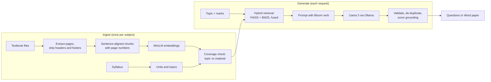

# AI Question Paper Generator

Upload a syllabus and the textbook or notes for any course, and get exam questions and full question papers that are tied to the syllabus, pitched at a chosen Bloom's taxonomy level, and traceable to the page they came from.

It runs entirely on your machine: retrieval with sentence embeddings and FAISS, generation with Llama 3 through [Ollama](https://ollama.com).

## What it does

- **Works for any subject.** Units and topics are read from the syllabus automatically (PDF, Word or text). No hand-written topic map.
- **Grounded questions.** Each question is written from passages retrieved from your material and reports its source pages and a grounding score.
- **Coverage check.** Syllabus topics that the uploaded material does not cover are flagged instead of being guessed at.
- **Difficulty control.** Marks decide the Bloom's taxonomy level: recall for 2 marks, analysis and evaluation for 10.
- **Full papers.** A configurable blueprint (sections, marks, either/or choices, sub-parts) produces a Word file with an examiner's key.
- **Web app, API and CLI** over the same core.

## How it works



1. **Ingest.** Pages are extracted, running headers and footers are removed, and the text is packed into sentence-aligned chunks of about 900 characters with one sentence of overlap. End-of-chapter exercise lists and bibliographies are skipped. Each chunk keeps its page range and is embedded with `all-MiniLM-L6-v2`.
2. **Read the syllabus.** A rule-based parser handles the common layouts (`Unit I`, `Module 2:`, dash, comma or bullet separated topics). If it finds little structure, Llama 3 extracts the units instead, and any topic that does not appear in the syllabus text is discarded.
3. **Check coverage.** Every topic is searched against the material. The number of passages above the similarity threshold becomes the topic's weight; zero means "not covered".
4. **Retrieve.** A topic query runs against a FAISS vector index and a BM25 keyword index. The two rankings are merged with reciprocal rank fusion, so exact terms (`CRC`, `IPv4`) and paraphrases both match. A vague topic such as "Design Issues" is searched together with its unit title; a specific one is searched on its own.
5. **Focus.** The best passage becomes the anchor, and the other passages must come from within a few pages of it, so a question is written from one section of the book rather than a mix of chapters.
6. **Generate.** The passages, the marks and the verbs for the Bloom level go to Llama 3, which must reply in JSON.
7. **Check the output.** A question is rejected and retried if it is too long, refers to "the passage" or "this unit", includes an answer, duplicates an earlier question, or scores too low against its sources. Accepted questions carry a grounding score: the cosine similarity between the question and its best source passage.

## Quick start

You need Python 3.10+, Node 18+ and [Ollama](https://ollama.com/download).

```bash
ollama pull llama3

python -m venv venv
venv\Scripts\activate            # macOS/Linux: source venv/bin/activate
pip install -r requirements.txt

# Index the bundled sample (a short syllabus and notes written for this repo)
python -m qpg ingest --name "Computer Networks" --syllabus examples/sample_syllabus.txt --textbook examples/sample_notes.txt

# Start the API
python -m qpg serve
```

In a second terminal:

```bash
cd frontend
npm install
npm run dev
```

Open http://localhost:5173.

### Command line

```bash
python -m qpg list
python -m qpg ask <subject-id> --unit 2 --marks 8 --count 3
python -m qpg ask <subject-id> --topic "three way handshake" --marks 2
python -m qpg paper <subject-id>
python -m qpg eval <subject-id> --n 20
```

### Docker

```bash
docker compose up --build
docker compose exec ollama ollama pull llama3
```

Then open http://localhost:8000.

## API

| Method | Path | Purpose |
|---|---|---|
| GET | `/api/health` | Server and model status |
| GET | `/api/subjects` | List subjects |
| POST | `/api/subjects` | Upload a syllabus and material; indexing runs in the background |
| GET | `/api/subjects/{id}` | Status, syllabus and topic coverage |
| DELETE | `/api/subjects/{id}` | Remove a subject |
| GET | `/api/subjects/{id}/search?q=` | Passages retrieved for a query |
| POST | `/api/subjects/{id}/questions` | Generate questions by unit, topic or keyword |
| GET | `/api/subjects/{id}/blueprint` | Default paper blueprint |
| POST | `/api/subjects/{id}/papers` | Start generating a paper |
| GET | `/api/papers/{id}` | Paper progress and content |
| GET | `/api/papers/{id}/download` | Word file |

Interactive docs are served at http://localhost:8000/docs.

## Configuration

Settings are environment variables; see [.env.example](.env.example). The ones most worth knowing:

| Variable | Default | Meaning |
|---|---|---|
| `QPG_LLM_MODEL` | `llama3` | Any model available in Ollama |
| `QPG_EMBED_MODEL` | `all-MiniLM-L6-v2` | Sentence-transformers model |
| `QPG_MIN_SIMILARITY` | `0.35` | Cosine similarity a passage needs to count as covering a topic |
| `QPG_CONTEXT_CHUNKS` | `3` | Passages given to the model per question |
| `QPG_NEIGHBOR_PAGES` | `8` | How far apart, in pages, those passages may be |
| `QPG_MIN_GROUNDING` | `0.45` | Questions scoring below this against their sources are retried |
| `QPG_EMBEDDER` | `st` | `hashing` is a dependency-free fallback used by the tests |

## Tests

```bash
pip install -r requirements-dev.txt
pytest
```

The tests swap in a hashing embedder and a fake language model, so the whole pipeline (ingest, retrieval, generation, paper export, API) runs in under a second with no model downloads. GitHub Actions runs them on every push.

## Evaluation

`python -m qpg eval <subject-id>` generates questions for a sample of topics and reports grounding, latency, first-try validity and whether a verb from the requested Bloom level was used. Results are saved as JSON under `results/`.

### Example run

A 962-page computer networks textbook and a five-unit university syllabus, on a laptop with Llama 3 and `all-MiniLM-L6-v2`:

| Measure | Result |
|---|---|
| Passages indexed | 3,135 |
| Syllabus topics found | 102, across 5 units, with no manual mapping |
| Topics matched to textbook material | 102 of 102 |
| Questions generated (20 topics sampled, 5 marks each) | 19 of 20 |
| Mean grounding score | 0.67 |
| Valid on the first attempt | 89.5% |
| Used a verb from the requested Bloom level | 100% |
| Mean time per question | 3.8 s (95th percentile 9.1 s, which includes model warm-up) |

### Choosing the model

An earlier version of this project compared two generators on 8 computer networks topics, using one retrieved passage per question:

| Model | SBERT similarity | BERTScore F1 | Seconds per question |
|---|---|---|---|
| Llama 3 | 0.74 | 0.85 | 1.42 |
| Flan-T5 | 0.55 | 0.85 | 5.17 |

Llama 3 was chosen on that basis. These figures are not comparable with the example run above: the topics, prompt and number of passages differ.

## Project layout

```
qpg/
  extract.py     PDF, Word and text extraction; header and footer removal
  chunking.py    sentence-aligned chunks with overlap and page numbers
  syllabus.py    syllabus parser (rules first, language model fallback)
  embeddings.py  sentence-transformers embedder and a hashing fallback
  index.py       FAISS vector search, BM25, reciprocal rank fusion
  ingest.py      the ingestion pipeline and coverage check
  bloom.py       Bloom's taxonomy levels and verbs
  generate.py    prompt, validation, de-duplication, grounding score
  paper.py       blueprint to paper, Word export
  evaluate.py    evaluation harness
  store.py       on-disk storage
  service.py     application service shared by the API and CLI
  api.py         FastAPI routes
  cli.py         command line
frontend/        React + Vite web app
tests/           pytest suite
examples/        sample syllabus and notes
docs/            walkthrough of the design
```

## Limitations

- Scanned PDFs have no text layer and need OCR first.
- Questions are drafts for a teacher to review, not a finished exam.
- Diagrams, equations and tables in the source are not understood.
- The grounding score measures similarity to the source, not correctness.

## Note on course material

Do not commit textbooks or syllabi you do not own. The `.gitignore` excludes `data/`, PDFs and Word files for that reason.
